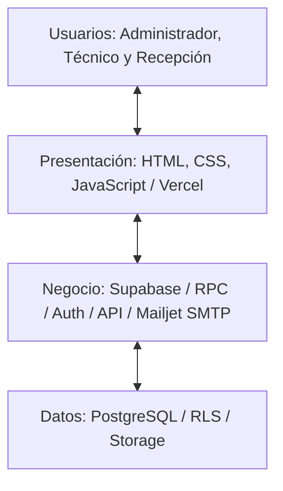

# Sistema de Gestión Hotelera - Hotel & Centro de Eventos El Almendro

Plataforma web full stack orientada a centralizar y digitalizar los procesos operativos de un hotel y centro de eventos, reemplazando registros dispersos en planillas Excel. Desarrollada a partir de requerimientos reales del cliente.

## Funcionalidades

- Panel de gestión operativa e indicadores.
- Mantenciones preventivas y reactivas.
- Inventario, activos y áreas.
- Proyectos, mejoras y remodelaciones.
- Solicitudes, tareas, calendario y carta Gantt.
- Gestión de trabajadores y documentación.
- Autenticación, roles, permisos y trazabilidad de actividades.

## Mi participación

**Pablo Gamboa - Desarrollador Full Stack y Scrum Master**

- Diseño de interfaces, estructura de base de datos y lógica de negocio.
- Implementación de módulos operativos y mecanismos de control de acceso.
- Levantamiento de requerimientos con usuarios del hotel.
- Coordinación del equipo mediante Scrum y Jira; despliegue en Vercel.

## Tecnologías

HTML, CSS, JavaScript, Tailwind CSS, TypeScript, PostgreSQL, Supabase, Vercel, GitHub y Jira.

## Arquitectura

El sistema se organiza en una arquitectura de tres capas, con separación de responsabilidades entre la interfaz, la lógica de negocio y la persistencia de datos.

| Capa | Tecnologías | Responsabilidad |
| --- | --- | --- |
| Presentación | HTML, CSS, JavaScript, Vercel | Interfaz web para administradores, técnicos y recepción. |
| Negocio | Supabase, funciones RPC, Auth/API, Mailjet SMTP | Reglas de negocio, autenticación y servicio de correo. |
| Datos | PostgreSQL, Row Level Security (RLS), Supabase Storage | Persistencia, almacenamiento de archivos y protección de datos. |

## Seguridad y calidad

- Autenticación mediante Supabase Auth y control de acceso por roles.
- Políticas RLS para restringir el acceso a registros en PostgreSQL.
- Organización modular del código para facilitar su mantenimiento.
- Seguimiento de estados, responsables e historial de actividades.

## Estado del sistema

Aplicación web desplegada y en validación con el cliente, con funcionalidades integradas y orientadas a sus procesos operativos reales.

## Estado del repositorio

Presentación inicial de portafolio. El código fuente y las instrucciones de instalación completas aún no se han incorporado. La revisión de privacidad, configuración y dependencias debe completarse antes de distribuir una copia del sistema. No se incluyen credenciales ni datos de producción en esta presentación.

Proyecto desarrollado en equipo. Esta descripción identifica las contribuciones personales indicadas por el autor y no concede derechos de redistribución del código original.
